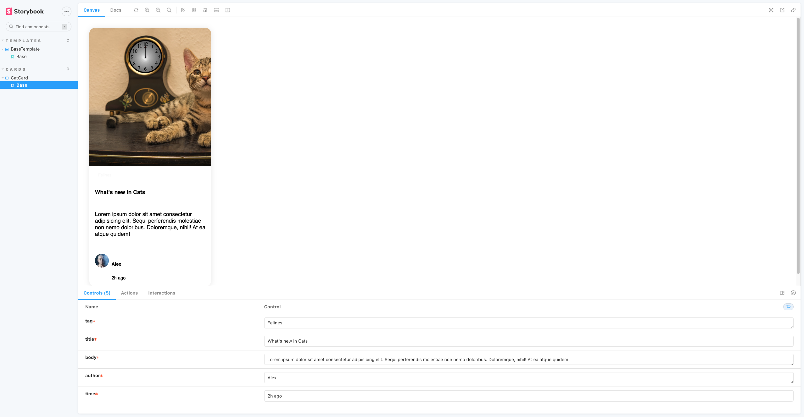

# Stardust — Micro-Frontend Monorepo (Next.js + Module Federation)

A micro-frontend architecture built with **Next.js 13** and **Module Federation**, managed as a **Lerna + Yarn workspaces** monorepo. Independent apps are developed and deployed separately while sharing components, theme, and layout from a central hub.

## Architecture

| Package | Role |
|---|---|
| `packages/hub001/website` | **Host / hub** — owns the shared UI: header, footer, theme, and the component library (`src/components`, `src/pages`) consumed by the other apps |
| `packages/news001/website` | **Remote app** — a news site (modeled on a StockX-style layout) that consumes the hub's shared components at runtime via `@module-federation/nextjs-mf` |

## Tech stack

- Next.js 13, React, TypeScript
- Module Federation (`@module-federation/nextjs-mf`)
- Lerna + Yarn workspaces (monorepo management)
- Tailwind CSS
- Husky + commitlint + ESLint (pre-commit lint, conventional commits)

## Getting started

```bash
# install everything (root)
yarn && yarn initpackages

# run an app
yarn hub    # hub001
yarn news   # news001

# format the whole repo
yarn prettier
```

Add a dependency to one package:

```bash
lerna add axios packages/hub001/website
```

## Component conventions

Shared components live in the hub and follow a fixed file pattern (interface, mocks, stories, styles, component):

```
components/templates/base/
├─ BaseTemplate.interface.ts
├─ BaseTemplate.mocks.ts
├─ BaseTemplate.stories.tsx
├─ BaseTemplate.styles.ts
└─ BaseTemplate.tsx
```

<p align="center">
  
</p>

## Roadmap (from the original build notes)

- Authentication/authorization with next-auth
- Shared state across apps (Redux Toolkit)
- Chatbot, calendar booking, and data-visualization modules
